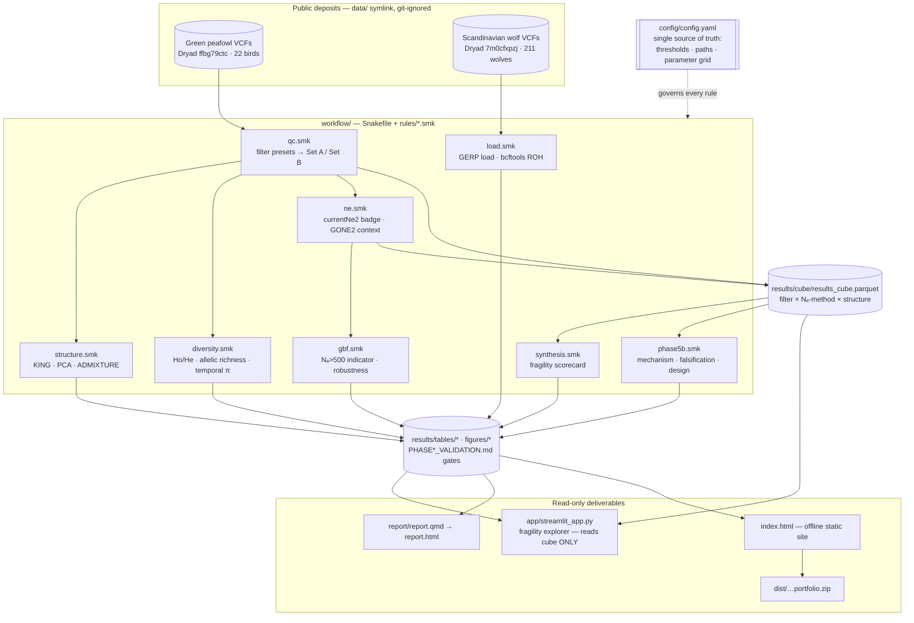

# Project map — Conservation Genomics Reanalysis

*Orientation for a fresh maintainer or agent. Map only: structure, flow, and where things live — pointers into the deep docs, not a re-explanation of them. Written 2026-10-21.*

**What it is:** a config-driven Snakemake reanalysis of two public genome deposits — endangered **green peafowl** (GBF indicators, contemporary *N*ₑ, structure, museum–modern diversity) and inbred **Scandinavian wolf** (GERP-weighted genetic load, ROH autozygosity) — built to show **how fragile each conservation verdict is to defensible analyst choices**, with a read-only explorer that makes that fragility visible.

**State:** Phases 0–5B **COMPLETE** (local acceptance gates). Only optional work remains (public hosting, a Phase-6 preprint). Full table: [PROJECT_STATUS.md](PROJECT_STATUS.md).

---

## Read this first — invariants you must not break

These are load-bearing. Breaking one silently corrupts results or the handoff.

1. **`config/config.yaml` is the single source of truth.** Every threshold, path, *N*ₑ setting, and the parameter grid live there. No rule in `workflow/` hard-codes a threshold. Change science by editing config, not code.
2. **Snakemake builds all products; the app only *reads* them.** `app/streamlit_app.py` reads `results/cube/results_cube.parquet` and tracked tables — it runs **zero** bioinformatics. Never move analysis into the app.
3. **Validators are fail-closed gates, not reports.** Each phase ends in a `results/PHASE*_VALIDATION.md` produced by a `scripts/python/validate_*.py`. A gate that can't reconcile with its anchor **exits non-zero**. Don't downgrade a gate to make it pass.
4. **Machine is Apple M1 / 8 GB RAM — RAM is the binding constraint.** Stream VCFs per-chromosome; never load a whole wolf VCF (12 GB deposit) into memory. Build the env with **micromamba, not classic conda** (classic conda OOM-kills, exit 137 — documented).
5. **Report before destructive or scope-changing moves.** Net-new files and doc edits are fine. Re-calling variants, reformatting the plan, deleting data, or **silently shrinking an analysis** are not — surface them first. Explain genomics reasoning inline; don't assume domain fluency in the reader.

---

## Pipeline map

Heavy bioinformatics runs in the Snakemake DAG. The cube + tables are the frozen interface everything downstream reads.



### Phases → Snakemake targets

| Phase | `snakemake … <target>` | Builds | Gate |
|---|---|---|---|
| 1 — peafowl QC / structure / diversity | `phase1` | QC counts, KING, PCA, ADMIXTURE, per-pop diversity, temporal π | `PHASE1_VALIDATION.md` |
| 2 — contemporary *N*ₑ + results cube | `phase2` | `results_cube.parquet`, GONE2 trajectory, metapop cross-check | `PHASE2_VALIDATION.md` |
| 3 — GBF Goal-A indicators | `phase3` | `gbf_ne500`, `gbf_robustness`, `gbf_summary` | `PHASE3_VALIDATION.md` |
| 4 — wolf load + ROH | `phase4` | `wolf_load.parquet`, `wolf_roh.parquet` | `PHASE4_VALIDATION.md` |
| 5A — communication package + reproducibility | `phase5a` | website, brief, report, sendable ZIP, clean-clone proof | `PHASE5A_VALIDATION.md` |
| 5B — mechanism / falsification / design | `phase5b` | wolf robustness, ROH localization, damage falsification, *N*ₑ design, integration | `PHASE5B_VALIDATION.md` |
| (default) `all` | *(no arg)* | Phases 1–4 + 5A gate + 5B extension | all of the above |

One-command reproduction of the current release:
```bash
snakemake --snakefile workflow/Snakefile phase5b --cores 4 --resources mem_mb=7000
```

---

## Directory map

```
CG/
├─ config/            ← SINGLE SOURCE OF TRUTH
│  ├─ config.yaml         every threshold, path, Nₑ setting, parameter grid
│  ├─ peafowl_popmap.tsv  sample → population (22 birds)
│  └─ peafowl_autosomes.txt / populations_maintained.tsv
├─ workflow/          ← the DAG (builds everything)
│  ├─ Snakefile           phase targets + `all`; includes the rules below
│  └─ rules/*.smk         qc · structure · diversity · ne · gbf · load · synthesis · phase5b · polish
├─ scripts/
│  ├─ python/             analysis + validators (validate_*.py = the fail-closed gates)
│  ├─ R/                  allelic_richness.R (hierfstat; R is conda-owned, see below)
│  └─ *.sh                build_tools · fetch_data · extract_data · filter_preset
├─ results/           ← build products (the frozen downstream interface)
│  ├─ cube/               results_cube.parquet (+ .csv mirror) — THE fragility cube
│  ├─ tables/ figures/    everything the app/report/site read
│  ├─ PHASE*_VALIDATION.md + *_VALIDATION.md  the gate outputs
│  ├─ ne/ wolf/ qc/       per-run intermediates (ne/ is ~7k files — expected)
│  └─ provenance/ logs/   run metadata + per-rule logs
├─ app/streamlit_app.py   ← fragility explorer (reads cube ONLY)
├─ report/report.qmd      ← paper-grade methods/results/limitations → report.html
├─ website/ + index.html  ← offline static portfolio site (editor.html = localhost text editor)
├─ brief/                 ← research brief: research_brief.(md|html), walkthrough.md, graphical_abstract.svg, screenshots/
├─ dist/                  ← conservation-genomics-reanalysis.zip (sendable, validated)
├─ data/                  ← VCFs, SYMLINKED to internal SSD + git-ignored (see data/README.md)
├─ tools/                 ← currentNe2 / GONE2, built from source (git-ignored; scripts/build_tools.sh)
├─ tests/                 ← test_streamlit_app.py (python -m unittest discover -s tests)
└─ renv/                  ← NOT used for reproduction; R is conda-owned. Ignore for the pipeline.
```

---

## Where to find X

| You want… | Go to |
|---|---|
| Run / reproduce the project | `README.md` → Reproduction; targets table above |
| Change a threshold / add a preset | `config/config.yaml` (never the rules) |
| The actual verdict, interactively | `streamlit run app/streamlit_app.py` |
| The verdict, as a paper | `report/report.html` (render: `report/render_report.sh`) |
| Current phase state / what's left | `PROJECT_STATUS.md` |
| The full execution plan + section numbers (§4–§13) | `CGplan.md` (77 KB — the authority on *why*) |
| How a conclusion was reached, errors & corrections | `RESEARCH_JOURNEY.md` |
| Proof it reproduces (hashes, RSS, isolated builds) | `results/PHASE5B_REPRODUCIBILITY.md` |
| Data layout / how to fetch | `data/README.md`; `scripts/fetch_data.sh` (needs `DRYAD_CLIENT_ID/SECRET`) |
| Build the *N*ₑ tools | `scripts/build_tools.sh`; `tools/README.md` |
| A field's meaning in the cube/tables | `results/PHASE5B_DATA_DICTIONARY.md` |
| Q&A, brief, and walkthrough | `FAQ.md`, `brief/` |

---

## The two chapters at a glance

**Green peafowl** (*Pavo muticus*, Dryad `ffbg79ctc`, 22 birds, pops Yunnan/Vietnam/Thailand)
- Two callsets: **Set A** (neutral, per-preset — unpruned for *N*ₑ, LD-pruned for structure) and **Set B** (lightly filtered, no MAF — diversity). The deposited pruned set is a *frozen validation reference only*; Set A is re-derived per preset.
- Headline (robust): no sampled population confidently clears GBF **N_e > 500** under any preset. Fragile: per-population estimates and even estimator convergence at n = 7/10/5.
- Phase 5B: **0/15** simulated designs resolve both truths (N_e 250 & 1000) → no sample prescription; **1/4** museum–modern diversity metrics survives damage/influence checks → geography still confounded, no temporal-erosion upgrade.

**Scandinavian wolf** (*Canis lupus*, Dryad `7m0cfxpzj`, 211 wolves)
- GERP-weighted load (realized vs masked, GERP thresholds {2,3,4}) + ROH autozygosity (`bcftools roh`, length cutoffs {0.1…2.0 Mb}).
- Phase 5B: **15/15** GERP × ROH cells support a positive partial realized-load association (after a generic-homozygosity negative control); authorized §13.4 localization = **24/24** cells beyond the circular-shift null at 1.5 Mb.
- Boundary language matters: this is **association between genomic proxies**, not fitness, individual harm, or causal inbreeding depression. §13.5 = `DEFER_DUPLICATES_SOURCE_STUDY`.

---

## Gotchas (non-obvious landmines)

- **Frozen vs re-derived peafowl Set A** — `set_a_neutral` in config is a *validation reference*; the workflow re-derives per-preset Set A from `norm_parent`. Don't wire the frozen file into *N*ₑ.
- **currentNe2 input is UN-pruned** — LD-Ne reads *N*ₑ *from* LD; pruning destroys the signal. Structure figures use the pruned derivative. Don't swap them.
- **`ne.snp_cap` is a runtime limit, not RAM** — currentNe2 pair work is ~quadratic in SNPs; the cross-chromosome estimate saturates far below the cap. Binary is patched to a fixed RNG seed for reproducibility.
- **GONE2 is context only** — not a cube axis, not in the badge. It aborts unless every chromosome is 20–1000 cM, so the trajectory is restricted to macrochromosomes (`min/max_chrom_cm`).
- **`data/` and `tools/` are git-ignored** — a clean clone has neither. `fetch_data.sh` + `build_tools.sh` recreate them; `data/peafowl` is a symlink to `~/Desktop/MMP/congen_data`.
- **`results/ne/` holds ~7k files** — that's the design/cross-check sweep, expected, not cruft.
- **Release no-op bridge** — on a record-free checkout, `SCIENCE_PASS` emits one release-content WARN until the canonical no-op is observed (promotes to PASS). Ordinary reproduction ignores this; it only matters to release maintainers. See `README.md` → Reproduction.
- **R is conda-owned (`environment.lock.yml`), `renv/` is not used** for reproduction.
