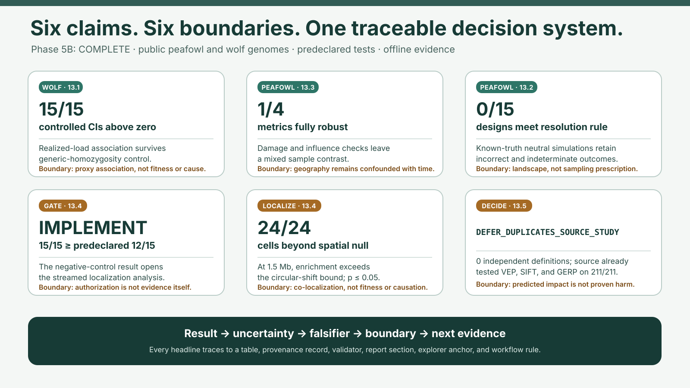

# Conservation Genomics Reanalysis

Assessing genetic status across the modern conservation-genomics toolkit — from the
new global biodiversity-treaty (GBF) indicators on an endangered SE Asian bird, to
realized-vs-masked genetic load in an inbred carnivore — and showing **how fragile
each verdict is to analyst choices**.

Two chapters:

1. **Green peafowl** (*Pavo muticus*) — GBF indicators, contemporary N_e, robustness,
   population structure, temporal erosion (museum vs modern). Dryad
   `10.5061/dryad.ffbg79ctc`.
2. **Scandinavian wolf** (*Canis lupus*) — genetic load (realized vs masked) and ROH
   inbreeding history. Dryad `10.5061/dryad.7m0cfxpzj`.

## Understand the project in 60 seconds



- **Question:** do conservation-genomics conclusions survive defensible analyst choices, or does
  the verdict move when filtering, population structure, deleteriousness, or ROH definitions move?
- **Green peafowl:** no sampled population confidently clears the GBF $N_e>500$ target under any
  filtering preset. The headline is robust, but population estimates and even estimator convergence
  are fragile at n = 7/10/5.
- **Scandinavian wolf:** stricter GERP and ROH thresholds change the numerical magnitude, while the
  biological pattern remains: inbred Scandinavian cohorts carry more realized than masked load and
  outbred references show the reverse.
- **Contribution:** a config-driven Snakemake reanalysis, four validation gates, and a read-only
  explorer that makes uncertainty visible instead of forcing uncertain estimates into pass/fail.
- **Boundary:** this demonstrates conservation risk and analytical sensitivity, not measured
  inbreeding depression or a new field estimate.

Admissions-ready path: [two-page illustrated brief](admissions/research_brief.html) ·
[research journey](RESEARCH_JOURNEY.md) · [interview notes](INTERVIEW_NOTES.md) ·
[2–3 minute demo script](admissions/demo_script.md) · [offline technical report](report/report.html)

## Deliverables

- **Reproducible repo** — one-command reproduction (`snakemake --cores N`), pinned
  `environment.lock.yml` (R packages included — R is conda-owned), the Snakefile, a
  config of all thresholds, the results cube, all figures, and a paper-grade `report/report.qmd`.
- **Fragility explorer** (`app/streamlit_app.py`) — a live tool whose two knobs
  (filtering stringency × structure modeled/ignored) wiggle the peafowl N_e / GBF
  pass-fail verdict in real time, alongside both GBF Goal-A indicators, a robustness
  matrix, and a GONE2 recent-trajectory context panel. (The N_e-method knob was dropped
  in Phase 2 — GONE2 measures a different time horizon, so it is context, not an axis.)
  A wolf tab separately exposes GERP and ROH-length sensitivity.

## Reproduction

```bash
# Build the pinned osx-64 toolchain. Classic conda OOM-kills on 8 GB RAM — use micromamba.
CONDA_SUBDIR=osx-64 micromamba create -n congen -f environment.lock.yml
micromamba activate congen
scripts/build_tools.sh                   # compile currentNe2 + GONE2 (pinned commits)
scripts/fetch_data.sh && scripts/extract_data.sh   # Dryad data (needs DRYAD_CLIENT_ID/SECRET)
snakemake --cores 4                      # build + validate all Phase 1-5A outputs, report, and brief
streamlit run app/streamlit_app.py       # explore the verdict

# Optional explicit checks (also run by the Phase-5A workflow gate):
python -m unittest discover -s tests -v
report/render_report.sh
```

R packages (SNPRelate / dartR / hierfstat / adegenet) ship with the conda env — **R is
conda-owned** (renv not used); for exact pins use `environment.lock.yml`.

## Layout

```
config/      ALL filtering thresholds, N_e settings, paths (config.yaml)
workflow/    Snakefile + rules/ (qc, structure, ne, gbf, load) — builds the results cube
scripts/     python/ + R/ analysis scripts called by the rules
results/      cube/ (results_cube.parquet) + tables/ + figures/
app/          streamlit_app.py — the fragility explorer (reads the cube)
report/       report.qmd — paper-grade methods/results/limitations
data/         raw VCFs + intermediates (symlinked to internal SSD; see data/README.md)
tools/        currentNe2 / GONE2 (built from source) — see tools/README.md
```

See **PROJECT_STATUS.md** for the current phase table, **CGplan.md** for the full execution plan,
and **SETUP.md** for environment setup status. Project status: **Phases 0–5A complete locally**
(peafowl QC → structure → diversity →
$N_e$ cube → GBF indicators + local explorer; wolf genetic load + ROH, validated to the
deposit's precomputed anchor; report/reproducibility hardening plus the admissions-facing scorecard,
evidence map, and offline communication package). The strict Phase-5A gate is **24 PASS / 0 FAIL**,
so Phase 6 is ready but remains an optional preprint stage.
