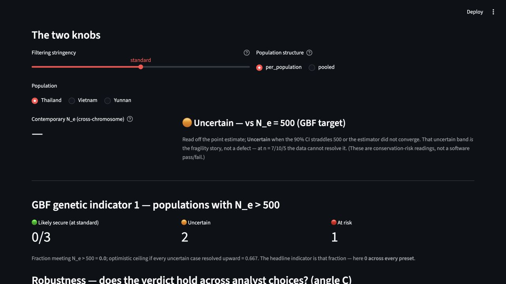
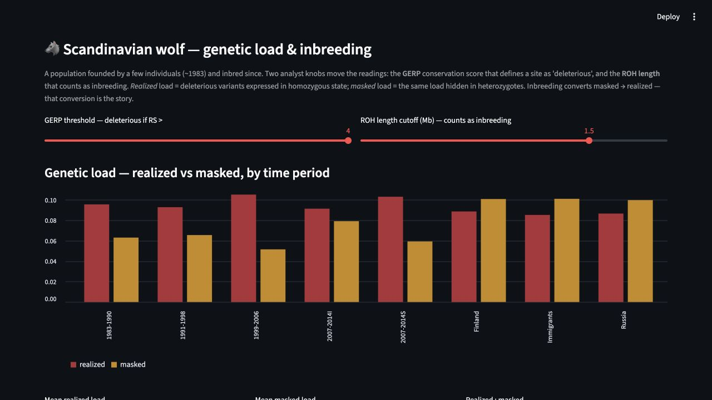

# Can we trust a conservation-genomics verdict?

## A two-page research brief

**Project type:** Reproducible computational reanalysis of two public whole-genome datasets

**Species:** Green peafowl (*Pavo muticus*) and Scandinavian wolf (*Canis lupus*)

**Central finding:** The peafowl's categorical result is stable even when its estimates are fragile;
the wolf's load magnitude changes with thresholds while the realized-versus-masked pattern remains
stable.

---

## Page 1 of 2 — Question, design, and results

### The biological question

Conservation indicators compress complex genomic evidence into a decision. This project asks:

> Does the decision remain the same when an analyst changes reasonable filtering, population-structure,
> deleterious-site, or run-of-homozygosity choices?

The goal is not to find the single most dramatic number. It is to separate **robust conclusions** from
**fragile magnitudes** and **insufficient evidence**.

### Study design

| Chapter | Public input | Project analysis | Main sensitivity axis |
|---|---|---|---|
| Green peafowl | Deposited modern VCF; 22 birds from Yunnan ($n=7$), Vietnam ($n=10$), and Thailand ($n=5$) | QC, PCA/ADMIXTURE, diversity, contemporary $N_e$, and two GBF indicators | Lenient/standard/strict filtering × population structure modelled/ignored |
| Scandinavian wolf | Deposited ancestral-polarized VCF, GERP scores, and load anchor; 211 wolves | Reproduced GERP-weighted load, then extended it with load and ROH sensitivity sweeps | GERP threshold 2/3/4 and ROH cutoff 0.1–2.0 Mb |

The workflow starts from deposited VCFs and records thresholds in
[`config/config.yaml`](../config/config.yaml). Snakemake performs the heavy analysis; the Streamlit
explorer reads precomputed outputs.

### Three results to remember

#### 1. A robust peafowl headline

Across all three filter presets, **0 of 3 sampled populations confidently pass $N_e>500$**. Vietnam's
lenient point estimate is above 500, but its 90% interval (139–37,795) crosses the threshold, so the
result is indeterminate rather than a pass. [Phase 2 evidence](../results/PHASE2_VALIDATION.md)

#### 2. Fragile estimates beneath that headline

Two of three populations change between `fail` and `indeterminate` as filtering changes, and several
stricter-filter estimates do not converge. The correct conclusion is therefore not “all three $N_e$
values are known to be below 500.” It is “none confidently clears 500 with these data and tested
choices.” [Phase 3 evidence](../results/PHASE3_VALIDATION.md)

#### 3. A stable wolf pattern with threshold-sensitive magnitude

At GERP $>4$, the workflow reproduces the deposit's realized and masked loads across all 211 wolves to
floating-point precision, with zero raw-count differences. Mean realized load changes from 0.172 to
0.136 to 0.093 as the threshold rises from 2 to 4, and mean $F_{ROH}$ changes from 0.226 to 0.167 as the
ROH cutoff rises from 0.1 to 2.0 Mb. The absolute values move, while the inbred-Scandinavian
realized-versus-masked direction remains stable. [Phase 4 evidence](../results/PHASE4_VALIDATION.md)

| Peafowl verdict explorer | Wolf load-and-ROH sensitivity explorer |
|---|---|
|  |  |

---

## Page 2 of 2 — Meaning, limitations, and contribution

### Why the result matters

The project demonstrates two forms of scientific maturity:

- A stable category does not make every underlying estimate precise.
- An uncertain or non-converged estimate is information about the limits of the data, not an invitation
  to report the point estimate alone.

The project's country-scale Populations Maintained calculation is 0.70, with a 0.70–0.70 band after
the live BirdLife country table was checked on 18 July 2026. All three sampled countries are counted
among the maintained cases, while none of their sampled populations confidently clears $N_e>500$.
This illustrates the difference between continued occurrence and demonstrated long-term genetic
security. The occurrence table remains coarse at country scale and needs finer occurrence evidence
for publication-level use. [GBF evidence](../results/tables/gbf_summary.tsv)

### What is known, and what would change it?

| Current conclusion | Dominant limitation | Most useful next evidence |
|---|---|---|
| No sampled peafowl population confidently clears $N_e>500$ | Only 5–10 individuals per population | More independently sampled individuals within each population |
| GONE2 suggests a recent decline, as context only | Borrowed recombination rate and macrochromosomes only | A peafowl-specific recombination map |
| Wolf threshold sweep supports stable realized-versus-masked direction | GERP threshold changes magnitude | Functional and fitness evidence before interpreting load as measured harm |
| Country-scale Populations Maintained is 0.70 | Coarse country-level occurrence categories | Current, finer sub-country occurrence records |
| Museum–modern diversity contrast is weak and metric-dependent | Geographic mismatch and ancient-DNA sensitivity | Matched locations/time points and damage-aware analysis |

Simply adding SNPs is not the first remedy for the peafowl result: currentNe2 already samples up to
25,000 SNPs per cell, while the number of individuals remains $7/10/5$.

### Claim boundary

This reanalysis identifies **conservation risk and analytical sensitivity**, not demonstrated
inbreeding depression. The temporal peafowl comparison is a weak contrast, not an erosion claim. GONE2
is context rather than part of the contemporary verdict. The wolf anchor proves computational fidelity
to the deposited calculation, not that every deleteriousness score predicts fitness.

### Reproducibility evidence

The four tracked phase validators report **32 PASS, 12 reported-not-asserted WARN, and 0 FAIL**. Warnings
surface scientific sensitivity rather than hiding it:

- [Phase 1](../results/PHASE1_VALIDATION.md) — QC, structure, diversity, and temporal contrast.
- [Phase 2](../results/PHASE2_VALIDATION.md) — currentNe2 cube, convergence, and context panels.
- [Phase 3](../results/PHASE3_VALIDATION.md) — GBF tables reconciled to the cube.
- [Phase 4](../results/PHASE4_VALIDATION.md) — exact wolf anchor and threshold sweeps.

### Contribution and assistance boundary

The source studies supplied the biological samples, deposited variants, annotations, and original
methods. The student project contributes the cross-cutting fragility question, the filter-by-structure
cube, the three-state verdict, the separation of contemporary and trajectory estimates, the wolf
sensitivity extensions, and the synthesis of what is robust versus unresolved. Existing bioinformatics
software performs the calculations. AI coding assistance supported planning, implementation, debugging,
review, and drafting; the student remains responsible for the chosen decisions, validation checks, and
scientific claims.

### Continue exploring

- [Research journey](../RESEARCH_JOURNEY.md) — how mistakes and evidence changed the design.
- [Interview notes](../INTERVIEW_NOTES.md) — definitions, figure reading, and spoken summary.
- [Rendered technical report](../report/report.html) — full methods, results, and limitations, usable offline.
- Explorer screenshot gallery: [peafowl verdict](screenshots/01-ne-gbf-verdict.jpg),
  [structure and diversity](screenshots/02-structure-diversity.jpg),
  [wolf load and ROH](screenshots/03-wolf-load-roh.jpg), and
  [limitations/evidence map](screenshots/04-about-limitations.jpg).
- [Human-readable results cube](../results/cube/results_cube.csv) — all peafowl verdict cells.

This brief is an admissions portfolio artifact, not a publication.
