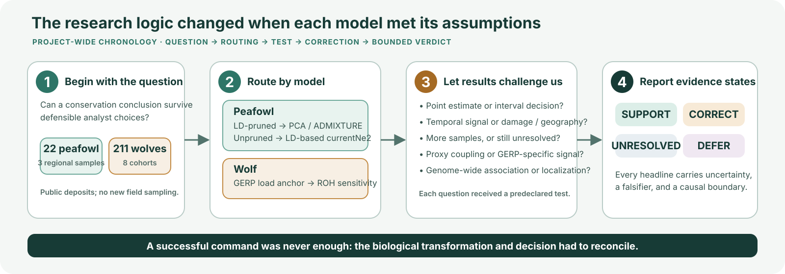
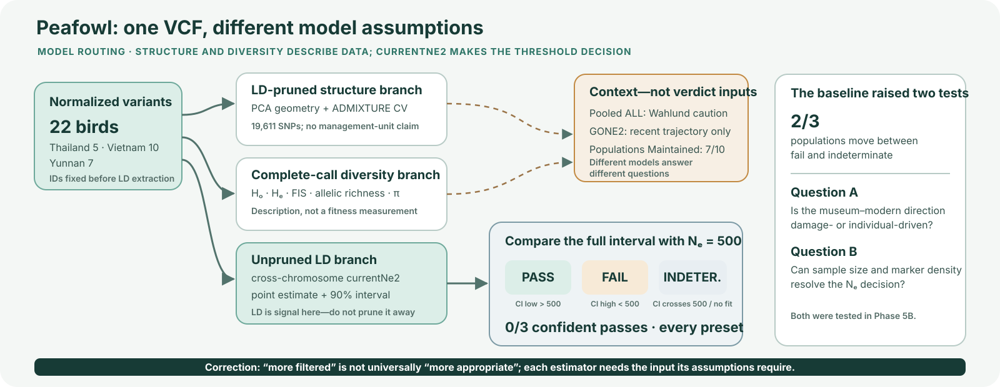
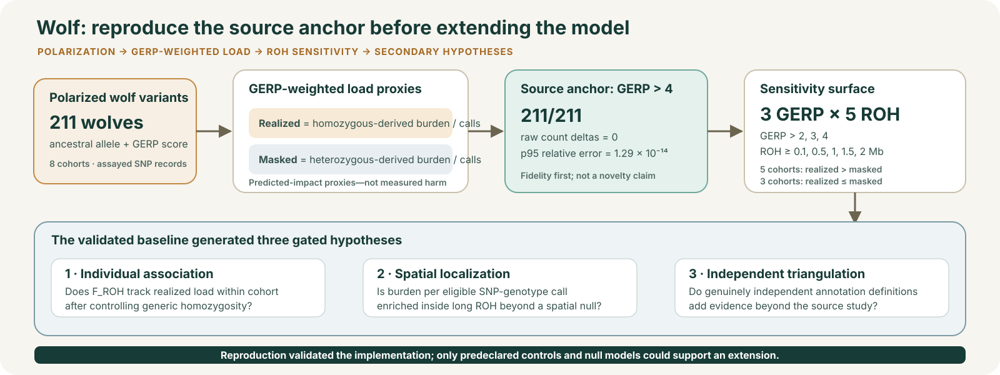
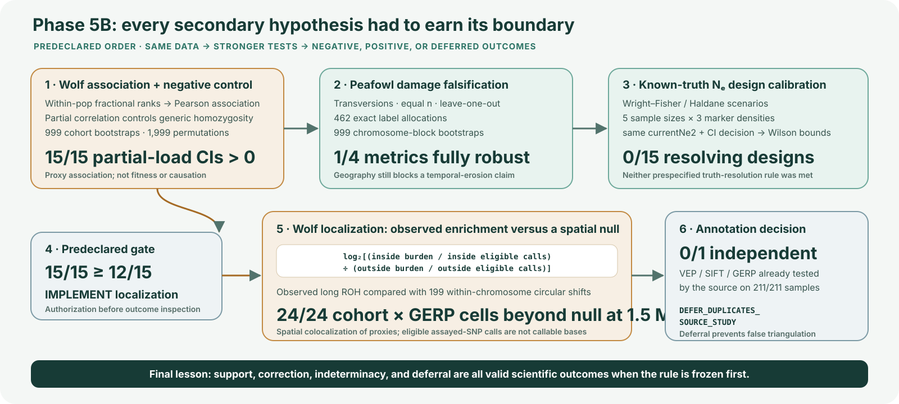

::::: {.brief-page data-page="1" aria-label="Page 1 of 4 — I began with a decision question, not a number"}

PROJECT-WIDE RESEARCH JOURNEY · PAGE 1 OF 4

# From public genomes to defensible conservation decisions

## I began with a decision question, not a number

<strong>Research brief</strong> · endangered green peafowl × inbred Scandinavian wolf · public genomic deposits · Phases 0–5B complete

::: {.hero-statement}
I began by asking whether a conservation-genomics conclusion stays stable when an analyst makes
different defensible choices. The project became a test of **reasoning under uncertainty**: choose the
model, expose its assumptions, preserve every outcome, and stop the claim where the evidence stops.
:::

:::: {.question-grid}
::: {.question-card}
### Green peafowl

Do 22 deposited genomes reveal regional structure, diversity differences, and sampled populations
that confidently clear the Global Biodiversity Framework (GBF) Goal-A threshold $N_e>500$?
:::

::: {.question-card}
### Museum comparison

Could five museum and six modern birds support a temporal genetic claim—or only a narrower diversity
contrast?
:::

::: {.question-card}
### Scandinavian wolf

Can the deposited GERP-weighted load result be reproduced exactly, and does its direction survive
different predicted-impact and ROH definitions?
:::
::::

{.model-diagram}

### The first correction changed the whole project

I initially expected one carefully filtered peafowl callset to serve every model. Testing the actual
transformations showed why that was wrong. PCA and ADMIXTURE need LD-pruned markers so linked blocks do
not dominate structure; currentNe2 estimates $N_e$ *from* LD, so pruning would erase part of its signal.
The source VCF also used `.` for every variant ID, causing a pruning extract to silently retain the
full callset. Unique chromosome–position–allele IDs reduced the standard set from **420,826 post-MAC
SNPs to 19,611 LD-pruned SNPs**.

That correction established my working rule: **a command finishing is not proof that it performed the
intended biological transformation**. Inputs must be routed by model assumptions, and every reported
result must reconcile to a machine table and an independent check.

::: {.ownership-note}
**Ownership boundary.** The source studies produced the samples, sequencing, deposited variants, and
base annotations (peafowl Dryad `10.5061/dryad.ffbg79ctc`; wolf Dryad
`10.5061/dryad.7m0cfxpzj`). My project contribution is the cross-analysis question, model routing,
sensitivity design, new falsification and calibration analyses, workflow, validators, and
evidence-bounded interpretation.
:::

Start with the question → route by model → let the result generate the next test

:::::

::::: {.brief-page data-page="2" aria-label="Page 2 of 4 — Peafowl, a stable headline built from fragile estimates"}

PEAFOWL · STRUCTURE, DIVERSITY &amp; Ne · PAGE 2 OF 4

## A stable headline emerged from fragile estimates

I used complementary models because no single statistic describes population status. LD-pruned PCA
showed separation among the three sampled groups, while ADMIXTURE cross-validation favoured $K=1$ in
this small dataset. I treated that disagreement as a reason to avoid a management-unit or current-
migration claim. Heterozygosity, allelic richness, and nucleotide diversity described variation;
they did not measure fitness. Thailand was least diverse, while Yunnan showed a heterozygote deficit.
In the five-museum-versus-six-modern comparison, $H_o$ and $\pi$ were marginally museum-higher, while
$H_e$ and allelic richness were essentially flat; because period was confounded with geography, this
remained a diversity contrast.

{.model-diagram}

### The decision model mattered more than the point estimate

For each filter preset and population, currentNe2 produced a point estimate and 90% interval. The
three-state rule was fixed before interpretation: **pass** only when the interval lies above 500,
**fail** only when it lies below 500, and **indeterminate** when it crosses 500 or the estimator does
not converge. The headline was stable—**0/3 sampled populations confidently passed under every
preset**—but **2/3 populations moved between fail and indeterminate**. Vietnam illustrates why:
$N_e=2{,}292.8$, yet its 90% interval was 139.09–37,794.98, so it was indeterminate, not a pass.

The separate Populations Maintained indicator was **7/10 range units**. It uses a different denominator
and answers a different question; presence in a range unit is not evidence that a sampled population
clears $N_e>500$. GONE2 likewise moved from a competing verdict model to a recent-trajectory context
panel because its time horizon and borrowed recombination assumption are not interchangeable with
currentNe2.

### The baseline generated two new questions

:::: {.next-question-grid}
::: {.next-question}
**Damage hypothesis.** The museum–modern direction was weak and geography was confounded with period.
Would it survive transversion filtering, equal-size comparisons, individual influence, exact labels,
and block uncertainty?
:::

::: {.next-question}
**Study-design hypothesis.** If the current data cannot resolve the threshold, which combinations of
sample size and marker density resolve known values below and above 500 when passed through the same
estimator and decision rule?
:::
::::

The comparative dataset was therefore narrowed from an underpowered temporal-$N_e$ idea to a diversity
contrast, and both questions were carried forward as explicit Phase-5B tests.

Headline robust: 0/3 confident passes · estimates and convergence fragile

:::::

::::: {.brief-page data-page="3" aria-label="Page 3 of 4 — Wolf, reproduce first and extend only through a gate"}

WOLF · REPRODUCTION &amp; SENSITIVITY · PAGE 3 OF 4

## I reproduced first, then allowed the evidence to open an extension

The wolf deposit offered a stronger computational anchor. I reconstructed ancestral-allele-
polarized, GERP-weighted realized and masked load at the source threshold, GERP $>4$. Across all
**211/211 wolves**, raw count differences were zero and the 95th-percentile relative error was
$1.29\times10^{-14}$. This validated allele polarization, formulas, and aggregation before I changed
any threshold; it did not turn a reproduction into a novel biological result.

{.model-diagram}

### The sensitivity surface separated direction from magnitude

I expanded the source anchor to GERP thresholds 2, 3, and 4, and summarized $F_{ROH}$ across five
minimum ROH lengths from 0.1 to 2 Mb. Stricter thresholds changed the numerical magnitudes, but all
**8/8 cohorts** preserved their realized-versus-masked group direction across the tested GERP
settings: five remained realized $>$ masked and three remained realized $\leq$ masked. This supported
robustness of direction, not a fitness conclusion: GERP, load, and ROH remain genomic risk proxies.

The baseline then generated three secondary hypotheses:

1. **Individual association:** within cohorts, does greater $F_{ROH}$ track greater realized load
   across the full 3×5 grid, and does that remain after controlling generic GERP-covered
   homozygosity?
2. **Spatial localization:** if that negative control passes a predeclared gate, is realized burden
   enriched inside long ROH beyond a within-chromosome spatial null?
3. **Annotation triangulation:** can at least one predicted-impact definition independent of the
   source study provide genuinely new evidence?

I froze the association grid, bootstrap and permutation counts, the **12/15 localization opening
gate**, the 1.5-Mb primary localization cutoff, and the annotation independence rule before seeing the
new outcomes. That ordering prevented an interesting result from deciding which analysis counted.

::: {.boundary-note}
**Claim boundary.** Exact reproduction establishes computational fidelity. A stable load direction or
$F_{ROH}$ association still does not measure harm, survival, reproduction, fitness, causal inbreeding
depression, or a management unit.
:::

Reproduce → vary defensible definitions → test a negative control → open or stop

:::::

::::: {.brief-page data-page="4" aria-label="Page 4 of 4 — Final verdict, scientific addition, and technical evidence"}

SECONDARY TESTS &amp; SYNTHESIS · PAGE 4 OF 4

## Every new claim had to earn its boundary

{.model-diagram .model-diagram--final}

**Phase 5B: COMPLETE.** Partial realized-load bootstrap intervals were above zero in **15/15** tested
GERP × ROH cells; damage-aware peafowl checks retained **1/4** fully robust metrics; **0/15** tested
sample-size × marker-density scenarios met both prespecified truth-resolution rules; the gate decision
was **IMPLEMENT**; localization placed **24/24** cohort × GERP cells beyond the circular-shift null at
1.5 Mb; and annotation triangulation was
**`DEFER_DUPLICATES_SOURCE_STUDY`** because there were 0/1 independent definitions with 211/211 source
sample overlap.

:::: {.synthesis-grid}
::: {.synthesis-card}
### Where the science landed

A headline can be stable while its estimates and convergence are fragile. Support, correction,
indeterminacy, and deferral are all results when the rule is frozen first. The wolf results support
association and spatial colocalization among genomic proxies. The peafowl results support a cautious
sample-status reading—not temporal erosion, a guaranteed sampling prescription, or a fitness claim.
:::

::: {.synthesis-card}
### What this project adds

This reanalysis adds a damage-aware falsification with exact-label randomization, a known-truth $N_e$
design calibration, a controlled 15-cell wolf association surface, a 199-replicate circular-shift
localization null, and a machine-traced decision framework. These are project contributions, not an
unsupported “first in the literature” claim.
:::
::::

### Conclusions remain reversible

- Wolf proxy-specific support is reconsidered below **12/15** controlled CI-positive cells; a
  localization cell changes if it no longer exceeds the null upper bound or $p>0.05$.
- A temporal peafowl upgrade requires **4/4** metrics *and* sampling that separates geography from
  period. A resolving design must meet the frozen Wilson bounds for true $N_e=250$ and 1,000.
- Annotation work reopens with ≥1 independent definition, ≥95% common-sample coverage, and ≥90%
  auditable denominator coverage.

::: {.evidence-chain}
**Technical evidence chain:** frozen config and seeds → Snakemake rules → VCF/QC and statistical
models → machine tables with uncertainty → independent validators → report and explorers → local,
offline ZIP. The workflow spans bcftools/VCFtools, PLINK, ADMIXTURE, currentNe2, GONE2, Python, R,
Quarto, Streamlit, deterministic packaging, and laptop-bounded execution.
:::

Every headline resolves through the
[`phase5b_claim_trace.tsv`](../results/tables/phase5b_claim_trace.tsv) to a result table, provenance,
validator, report anchor, explorer, workflow rule, and numeric falsifier. Reproduce with
`snakemake --snakefile workflow/Snakefile phase5b --cores 4 --resources mem_mb=7000`; then continue to
the [technical report](../report/report.html), [offline explorer](../index.html), or
[research journey](../RESEARCH_JOURNEY.md).

Final verdict: uncertainty is not beside the result—it is part of the result.

:::::
